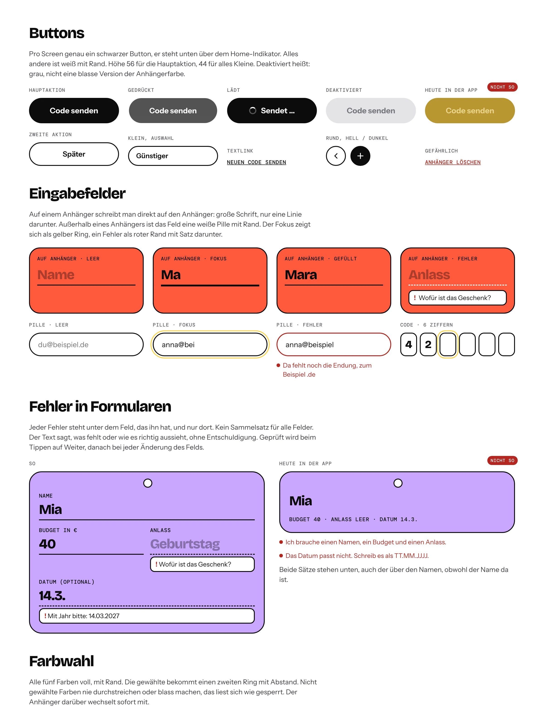
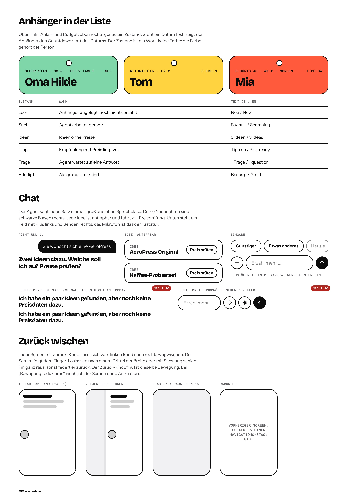

# Building blocks (package 6)

Rules for buttons, fields, form errors, colour picker, tag status, chat, back swipe and wording, each next to today's state marked "Nicht so". Implementation: issue #61.

