# Onboarding design (package 4)

Mockups in the gift-tags style, German copy. Implementation: issues #59 (onboarding), #60 (magic link) and the Apple/Google sign-in issue.

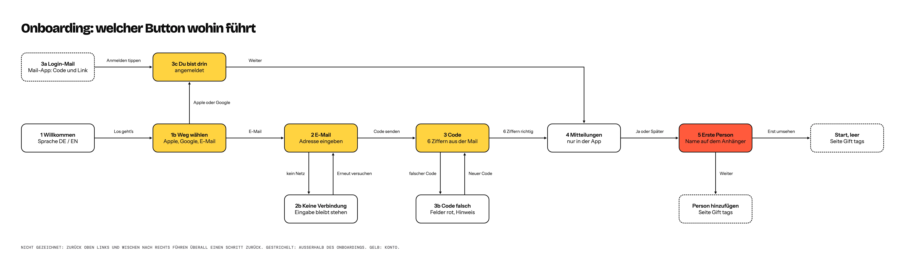

| Screen | |
|---|---|
| 1 Welcome: tag stack, DE/EN switch | 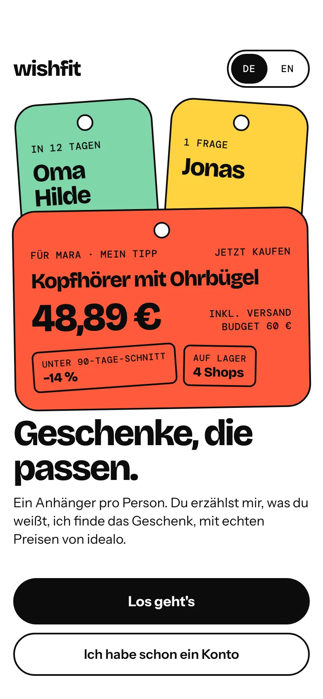 |
| 1b Sign-in method: Apple (Apple devices only), Google, e-mail | 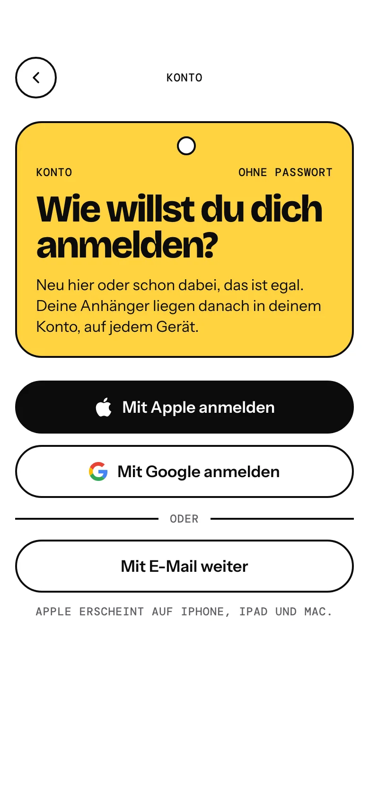 |
| 2 E-mail | 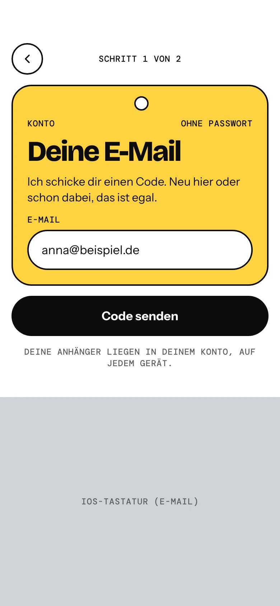 |
| 2b No connection | 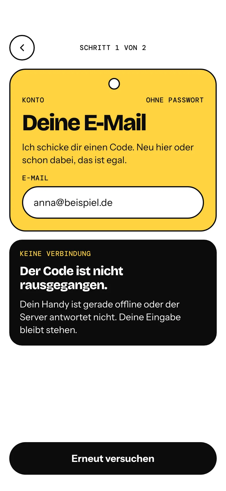 |
| 3 Code: six digit fields | 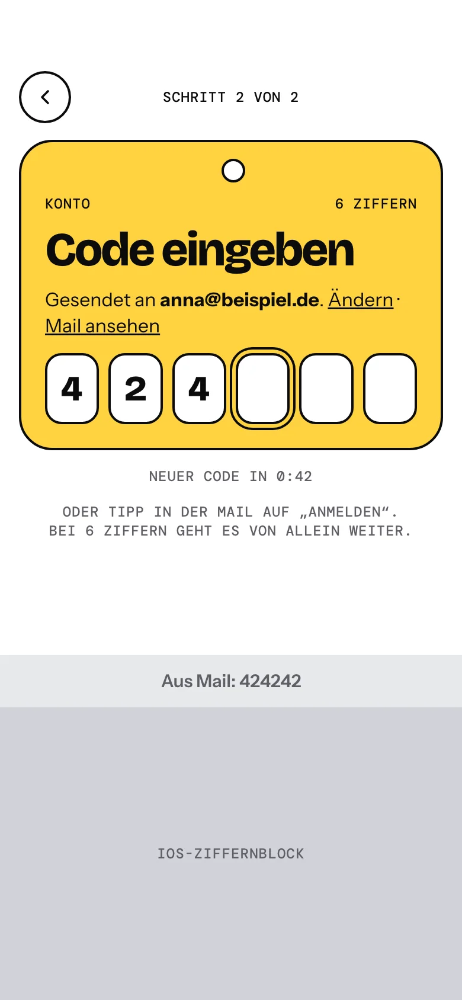 |
| 3a Sign-in mail: code and magic link | 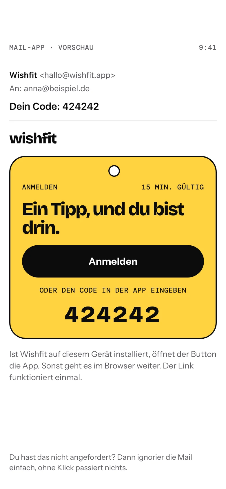 |
| 3b Wrong code | 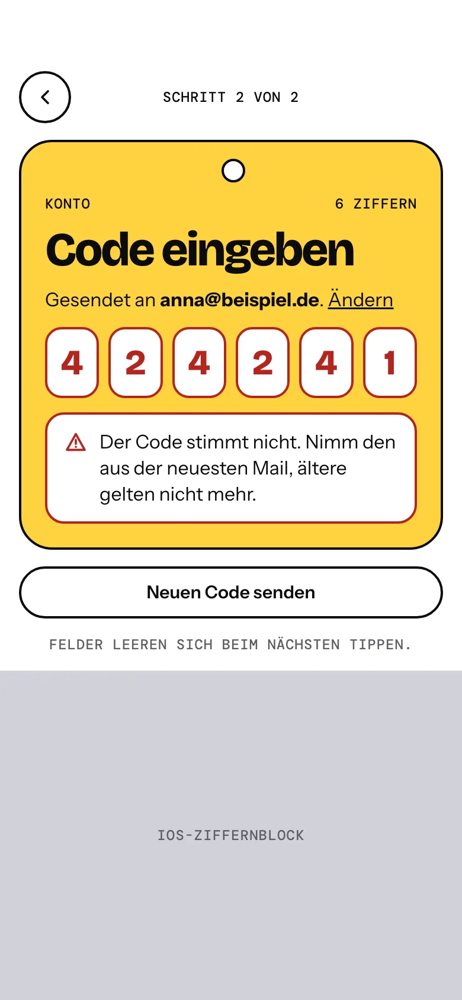 |
| 3c Signed in (after Apple, Google or the link) | 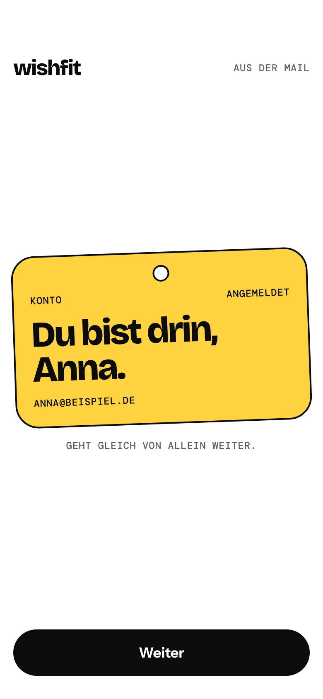 |
| 4 Notifications | 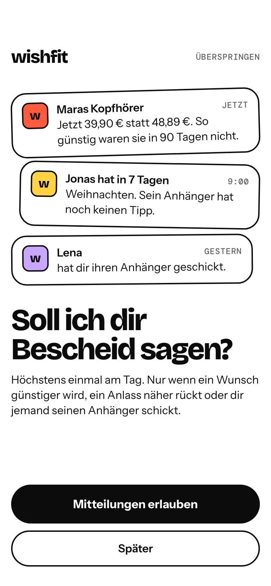 |
| 5 First person | 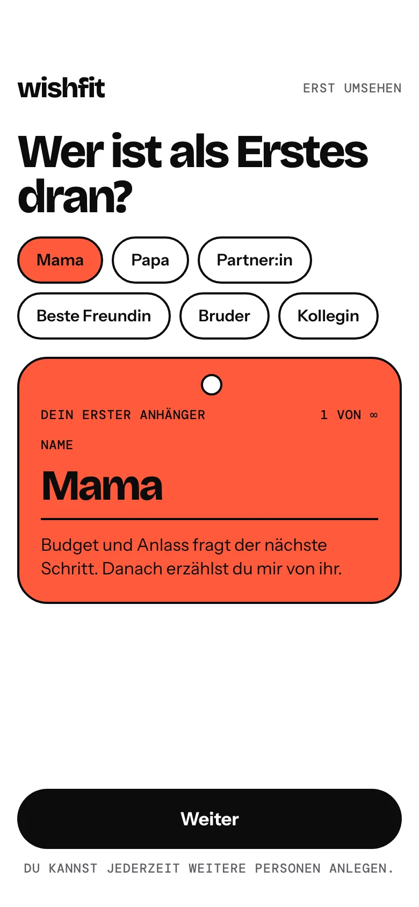 |

Back button and swipe from the left edge go one step back everywhere; not drawn in the flow.
